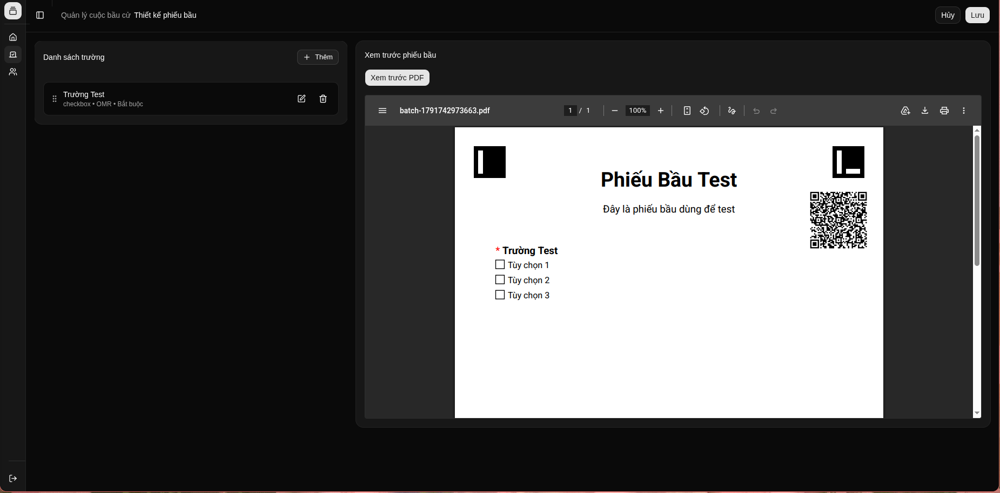
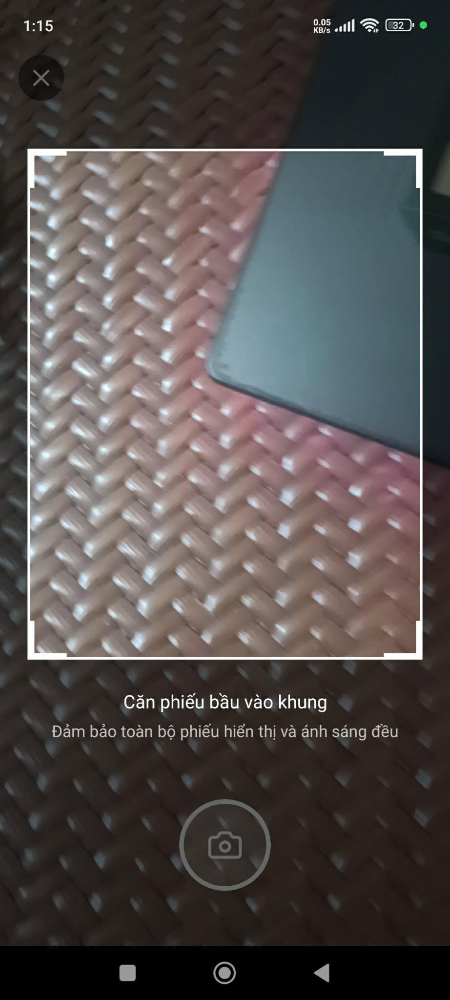
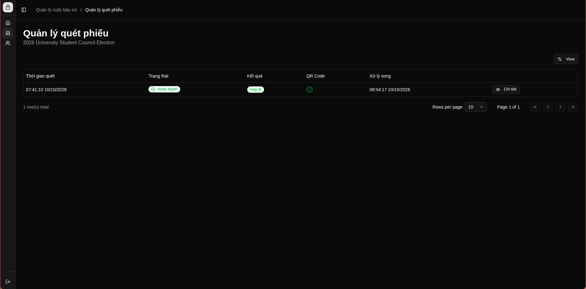
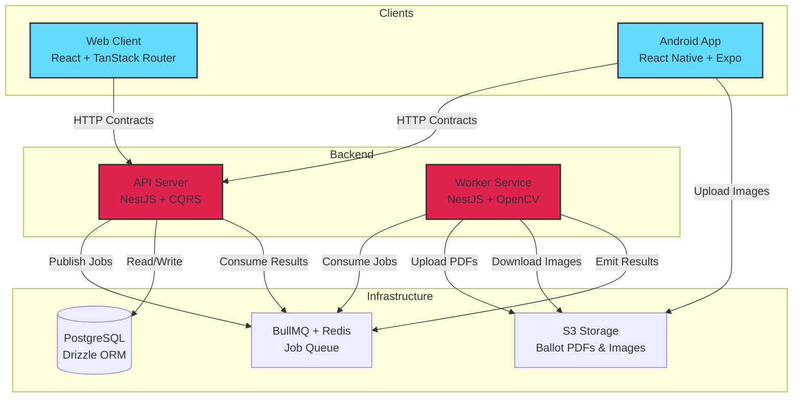

# Signa

> **Election management platform with dynamic ballot generation, computer vision-based scanning, and distributed processing**

A showcase of advanced software architecture patterns including Domain-Driven Design, CQRS, Clean Architecture, and event-driven processing with ArUco marker alignment and OMR (Optical Mark Recognition).

[](https://www.typescriptlang.org/)
[](https://nestjs.com/)
[](https://reactjs.org/)
[](https://reactnative.dev/)
[](https://nx.dev/)
[](https://opencv.org/)

---

## Overview

Signa enables dynamic ballot creation with a visual form builder, generates tamper-proof PDFs embedded with ArUco markers and HMAC-signed QR codes, and processes scanned ballots using computer vision for perspective correction and mark detection.


<p><em>Visual ballot builder with drag-and-drop field positioning</em></p>


<p><em>Mobile ballot scanning with real-time preview</em></p>


<p><em>Scan results dashboard with validation status</em></p>

---

## System Architecture



**Key Flow:**
1. **Ballot Generation**: API publishes job → Worker generates PDF with ArUco markers + QR code → Uploads to S3 → Emits completion
2. **Ballot Scanning**: Android uploads image to S3 → API publishes scan job → Worker downloads image → Applies ArUco alignment → OMR detection → Emits result → API validates and stores

---

## Architectural Highlights

### 1. **Custom Type-Safe Contract System**

HTTP endpoints defined as contracts with automatic path parameter validation and DTO generation:

```typescript
// Contract definition with compile-time safety
export const updateElectionContract = defineContract({
  method: "PUT",
  path: "/elections/:id",
  params: z.object({ id: electionIdSchema }),
  body: z.object({ formStructure: formStructureSchema }),
  response: electionReadModelSchema
});

// Controller using contract - params/body automatically typed and validated
@ContractRoute(updateElectionContract)
@Protected()
@Policy(isAdmin)
async update(@Param() params, @Body() body) {
  return this.commandBus.execute(new UpdateElectionCommand(params.id, body));
}
```

### 2. **CQRS with Pragmatic Query Optimization**

- **Commands** flow through domain entities and repositories (write model with business logic)
- **Queries** use query builder directly (read model optimized for performance)

```typescript
// Command - goes through domain
@CommandHandler(UpdateElectionCommand)
class UpdateElectionHandler {
  async execute(command) {
    const election = await this.repo.findById(command.id); // Entity from domain
    election.updateDetails(command.data); // Business logic in entity
    await this.repo.save(election);
  }
}

// Query - direct database access
@QueryHandler(ListElectionsQuery)
class ListElectionsHandler {
  async execute(query) {
    return this.db.query.elections // Drizzle query builder
      .findMany({ where: eq(elections.status, query.status) });
  }
}
```

### 3. **Composable Authorization Policies**

Authorization DSL with boolean composition:

```typescript
// Policy definitions
const isAdmin = policy({
  name: "admin.access",
  evaluate: hasRole(ROLES.SUPER_ADMIN)
});

const isOwner = policy({
  name: "resource.owner",
  evaluate: and(
    hasPermission("resource.write"),
    resourceSatisfies((user, resource) => resource.ownerId === user.id)
  )
});

// Applied via decorator
@Policy(or(isAdmin, isOwner))
async updateResource(@Resource() resource) { ... }
```

### 4. **Clean Architecture with DDD**

Each bounded context follows layered architecture:

```
modules/ballot/
├── domain/              # Pure business logic
│   ├── entities/        # Aggregates (Ballot, BallotScanResult)
│   ├── value-objects/   # BallotId (extends ValueObject<string>)
│   └── ports/           # Repository interfaces
├── application/         # Use cases
│   ├── commands/        # Write operations (GenerateBallots, ProcessScan)
│   ├── queries/         # Read operations (ListBallots)
│   ├── handlers/        # Command/Query handlers + Job result handlers
│   └── ports/           # External service interfaces
├── infrastructure/      # Adapters
│   ├── persistence/     # Repository implementations (Drizzle)
│   └── adapters/        # External service adapters
└── presentation/        # Controllers + DTOs
```

### 5. **Computer Vision Pipeline with OpenCV**

Multi-stage processing for robust ballot scanning:

```typescript
// 1. Detect ArUco markers (4 corners)
const markers = arucoService.detectMarkers(imageBuffer);

// 2. Calculate perspective transform matrix
const transform = arucoService.calculateAlignment(markers, expectedPositions);

// 3. Apply warp to correct camera angle/distortion
const alignedImage = cv.warpPerspective(image, transform, size);

// 4. Verify HMAC-signed QR code
const { ballotId, signature } = qrService.decode(alignedImage);
const isValid = verifyHmac(ballotId, signature, secretKey);

// 5. OMR detection with confidence scoring
const marks = markDetectionService.detect(alignedImage, fieldLayouts);
// Returns: { fieldId, selectedValues, confidence: 0.95 }
```

### 6. **Event-Driven Architecture with BullMQ**

Asynchronous job processing with result emission:

```typescript
// Worker: Process job and emit typed result
@JobHandler(processBallotJob)
async handleProcessBallot(job: Job) {
  const result = await this.scanningService.process(job.data);
  return result; // Automatically emitted to results queue
}

// API: Subscribe to results
@OnJobResult(processBallotJob)
async handleOmrResult(result: JobResult<ScanResult>) {
  const scanResult = BallotScanResult.create(result.data);
  await this.validator.validate(scanResult);
  await this.repo.save(scanResult);
}
```

---

## Project Structure

| Component | Description | Technology Stack |
|-----------|-------------|------------------|
| **apps/api** | RESTful API server with CQRS | NestJS, Drizzle ORM, PostgreSQL, JWT auth |
| **apps/web** | Admin web interface | React, TanStack Router, TanStack Query, Shadcn UI |
| **apps/android** | Mobile ballot scanner | React Native, Expo, Expo Camera |
| **apps/worker** | Background job processor | NestJS, OpenCV, BullMQ, Sharp |
| **packages/contracts** | Type-safe API/Queue contracts | Zod schemas, shared types |
| **packages/dsl** | Custom framework abstractions | HTTP contracts, Policy DSL, Queue contracts |
| **packages/nest** | NestJS extensions | Contract decorators, Policy guards, Queue workers |
| **packages/react/ui** | Shared UI components | React, Tailwind CSS, Radix UI |
| **packages/shared** | Cross-platform utilities | Type definitions, validation schemas |

---

## Tech Stack

### Frontend
- **Web**: React 18, TanStack Router v1 (file-based routing), TanStack Query, Shadcn UI, Tailwind CSS
- **Mobile**: React Native, Expo 51, Expo Camera, NativeWind, Expo Router

### Backend
- **API**: NestJS, CQRS (@nestjs/cqrs), Drizzle ORM, PostgreSQL, Passport JWT
- **Worker**: NestJS, OpenCV.js (@techstark/opencv-js), js-aruco2, Sharp, QRCode, PDFKit

### Infrastructure
- **Queue**: BullMQ, Redis
- **Storage**: AWS S3 (via @aws-sdk/client-s3)
- **Monorepo**: Nx 23, pnpm workspaces
- **Type Safety**: TypeScript 5.7, Zod validation

### Architecture Patterns
- Domain-Driven Design (DDD)
- Command Query Responsibility Segregation (CQRS)
- Clean Architecture (Ports & Adapters)
- Event-Driven Architecture
- Repository Pattern
- Policy-Based Authorization

---

## Documentation

- [**Architecture Deep Dive**](docs/architecture.md) — Detailed explanation of DDD layers, CQRS flow, and design decisions
- [**Features Gallery**](docs/features.md) — Complete screenshot walkthrough of all features
- [**Ballot Security**](docs/ballot-security.md) — ArUco marker system, HMAC signing, and OMR algorithm

---

## License

MIT

---

<p align="center">
  <em>Built with TypeScript, NestJS, React, and React Native</em>
</p>
