# Features Gallery

Complete walkthrough of Signa's features with screenshots.

---

## Table of Contents

1. [Admin Web Application](#admin-web-application)
   - [Authentication](#authentication)
   - [Dashboard](#dashboard)
   - [Election Management](#election-management)
   - [Ballot Builder](#ballot-builder)
   - [Clerk Management](#clerk-management)
   - [Scan Results](#scan-results)
2. [Android Mobile App](#android-mobile-app)
   - [Authentication](#mobile-authentication)
   - [Home Screen](#home-screen)
   - [Ballot Scanning](#ballot-scanning)
   - [Scan History](#scan-history)
   - [Settings](#settings)

---

## Admin Web Application

### Authentication

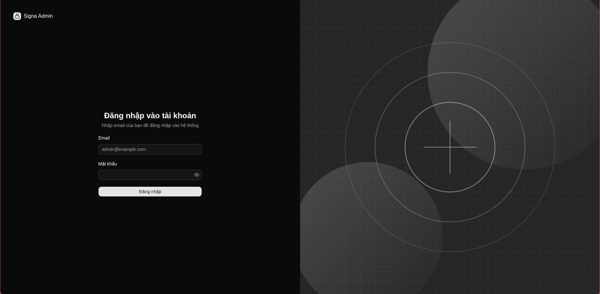

**Admin login interface**
- Secure JWT-based authentication
- Role-based access control (Super Admin, Admin, Clerk)
- Session management with refresh tokens

---

### Dashboard

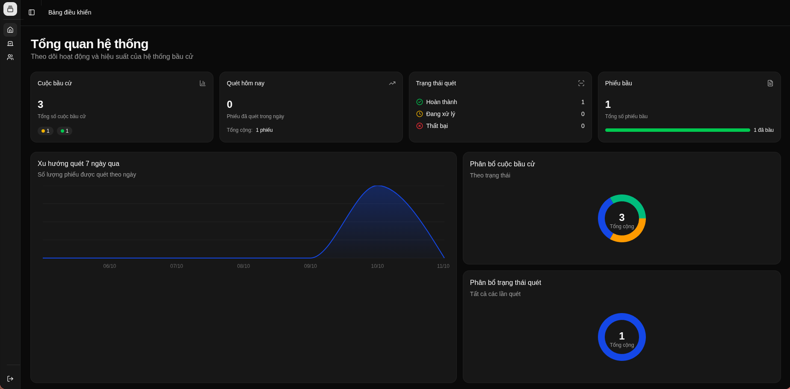

**Main dashboard overview**
- Real-time statistics for active elections
- Recent scan activity
- Quick actions for common tasks
- System health indicators

---

### Election Management

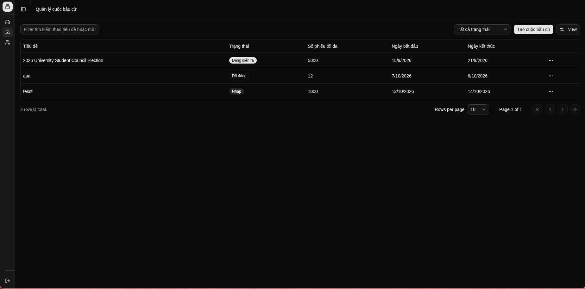

**Elections management table**
- Create, edit, and manage elections
- Track election status (Draft, Active, Closed)
- Configure start/end dates and voter limits
- Bulk operations support

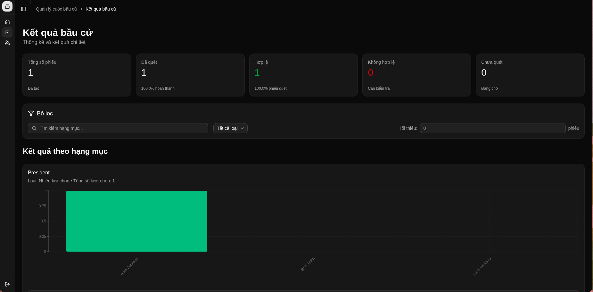

**Election results dashboard**
- Real-time vote tallying
- Visual charts and statistics
- Export results to PDF/CSV
- Audit trail for all actions

---

### Ballot Builder


**Visual ballot builder**
- Drag-and-drop field positioning
- Support for multiple field types:
  - Text input fields
  - Single-choice (radio buttons)
  - Multiple-choice (checkboxes)
- Real-time preview
- Responsive layout editor

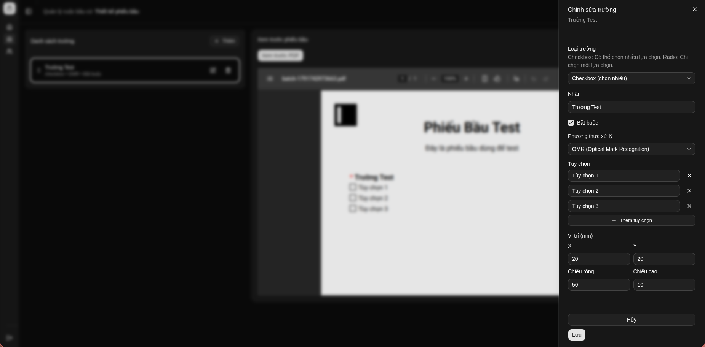

**Field properties editor**
- Configure field type and validation rules
- Set OMR detection zones for checkboxes/radio buttons
- Define field labels and options
- Position and size controls
- Required field toggles

**Key Features:**
- **Dynamic ballot generation**: No fixed templates - create any ballot structure
- **Precise OMR positioning**: Visual editor for checkbox/radio button detection zones
- **PDF generation**: Automatically generates print-ready PDFs with embedded ArUco markers
- **QR code integration**: Each ballot gets unique HMAC-signed QR code for verification

---

### Clerk Management

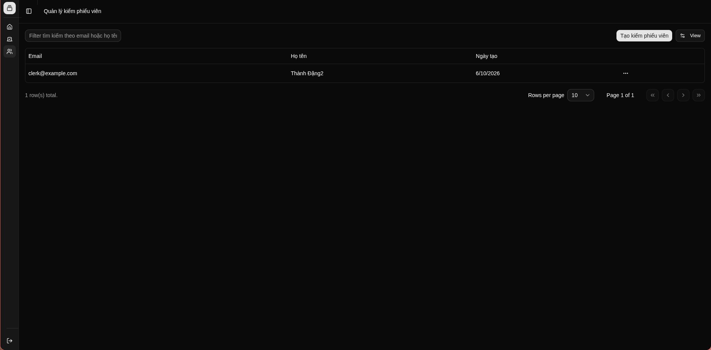

**Clerk management interface**
- Add and manage clerk accounts
- Assign roles and permissions
- Track clerk activity
- Bulk import/export

---

### Scan Results

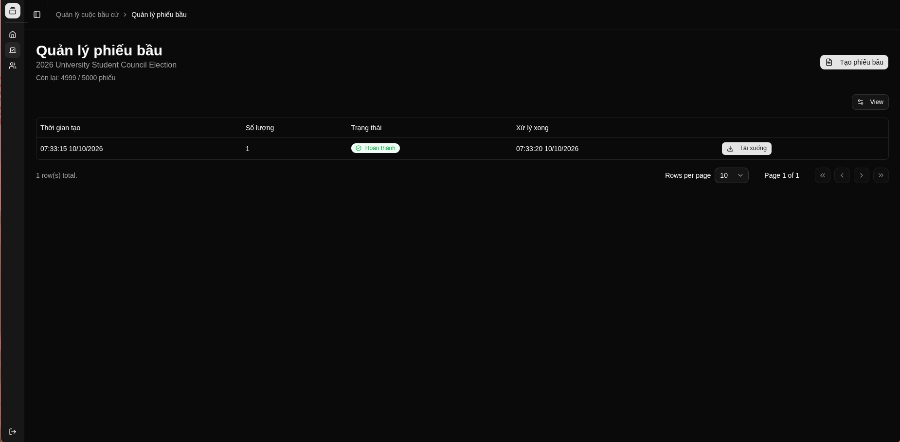

**Ballot PDF batches overview**
- Track ballot generation jobs
- Download generated PDF batches
- Monitor generation status
- Batch metadata and timestamps


**Scan results table**
- View all processed ballot scans
- Filter by validation status:
  - ✅ Valid
  - ❌ Invalid (markers/QR/selections/confidence)
  - 🚫 Rejected (election closed)
- Search and pagination
- Export to CSV

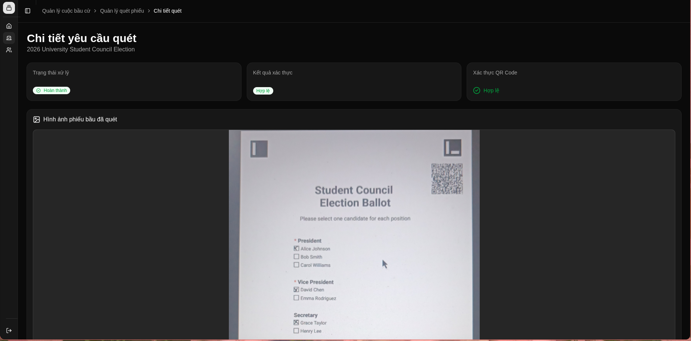

**Detailed scan result view**
- Selected field values with confidence scores
- QR verification status
- Processing metadata (markers detected, alignment applied)
- Validation errors if any
- Original scan timestamp and user
- Option to review and override (for edge cases)

**Validation Pipeline:**
1. **Marker Detection**: Verify 4 ArUco markers detected
2. **QR Verification**: Validate HMAC signature of ballot ID
3. **Selection Validation**: Check selections match ballot structure
4. **Confidence Check**: Ensure OMR confidence > 75% threshold
5. **Election Status**: Reject if election is closed

---

## Android Mobile App

### Mobile Authentication

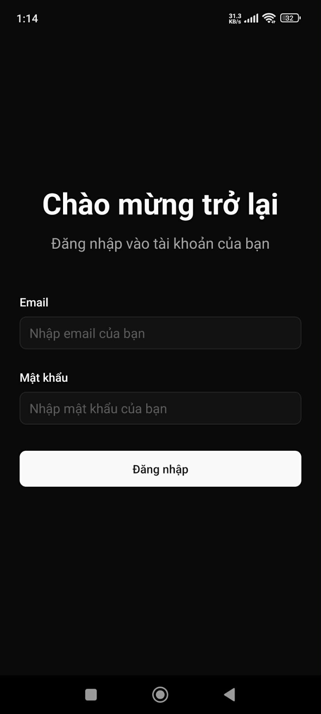

**Mobile authentication**
- Same JWT authentication as web
- Secure token storage with Expo SecureStore
- Biometric authentication support (future)

---

### Home Screen

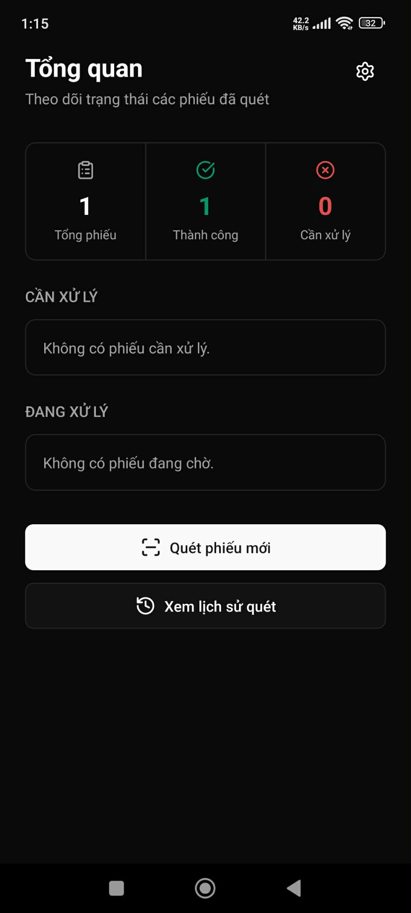

**Scan overview dashboard**
- Recent scan requests with status
- Processing requests (pending/in progress)
- Completed scans (valid/invalid)
- Failed scans requiring attention
- Quick access to scan new ballot

**Status Categories:**
- 🟢 **Successful**: Valid scans accepted
- 🟡 **Processing**: Currently being analyzed by worker
- 🔴 **Attention Required**: Failed scans or validation errors

---

### Ballot Scanning


**Camera interface**
- Real-time camera preview
- Alignment guides for ballot positioning
- Auto-focus and exposure controls
- Capture button with haptic feedback

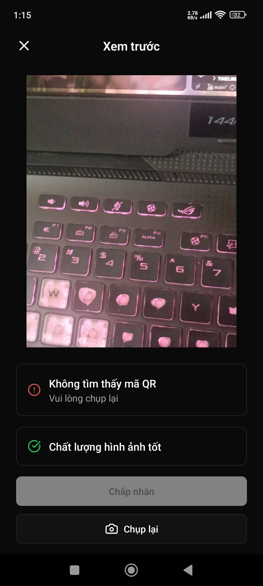

**Scan preview confirmation**
- Review captured image before submission
- Retake if quality is poor
- Automatic upload to S3 on confirmation
- Optimistic UI updates

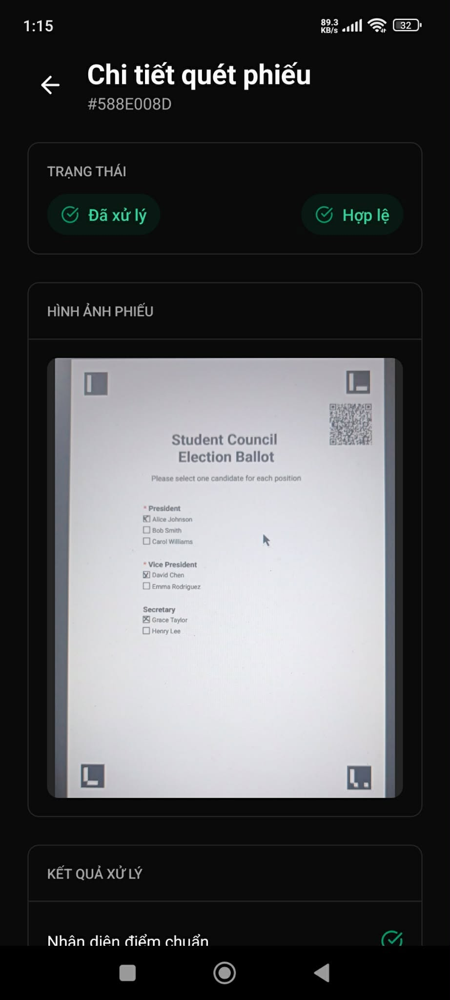

**Scan processing details**
- Real-time status updates (polling every 5s)
- Processing stages:
  1. Uploaded to storage
  2. Queued for processing
  3. Detecting markers
  4. Applying alignment
  5. Verifying QR code
  6. Detecting marks
  7. Validating selections
- Final result with validation status
- Detailed error messages if failed

**Technical Flow:**
1. User captures image with camera
2. App requests presigned S3 upload URL from API
3. Image uploaded directly to S3 (bypasses API server)
4. App sends scan processing request to API with S3 key
5. API validates ballot exists and election is active
6. API publishes job to BullMQ queue
7. Worker processes image (ArUco + OMR)
8. Worker emits result to results queue
9. API consumes result and updates database
10. Mobile app polls for status updates

---

### Scan History

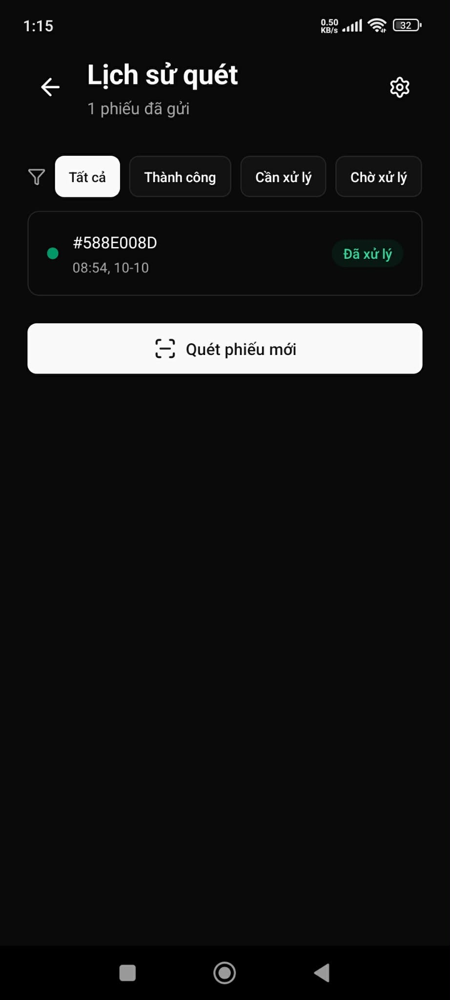

**Complete scan history**
- Chronological list of all scans
- Status badges for quick identification
- Tap to view detailed results
- Pull to refresh
- Infinite scroll pagination

---

### Settings

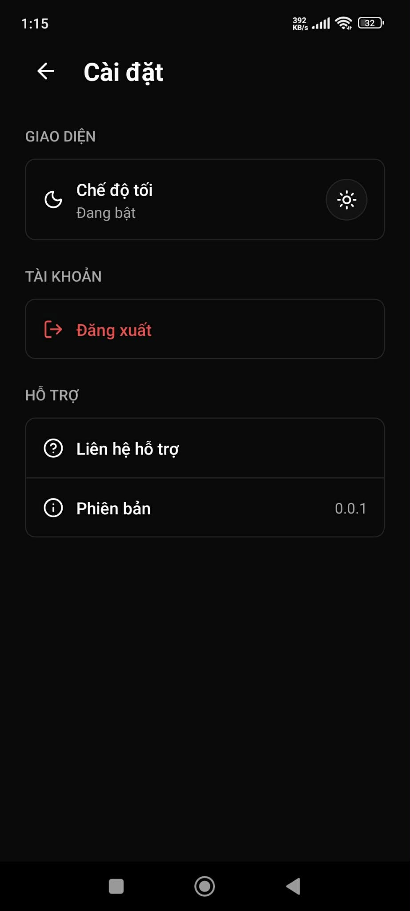

**Application settings**
- API endpoint configuration (for dev/staging/prod)
- Theme preferences (light/dark mode)
- Camera settings
- Clear cache and logout

---

## User Workflows

### Workflow 1: Create Election and Generate Ballots

```
1. Admin logs in to web app
2. Navigate to Elections → Create New
3. Fill in election details (title, dates, voter limit)
4. Open Ballot Builder
5. Add fields:
   - Drag text field for "Name"
   - Add radio buttons for "Candidate Selection"
   - Position OMR zones precisely
6. Preview ballot
7. Save election (status: Draft)
8. Click "Generate Ballots" → Enter count (e.g., 100)
9. System generates 100 unique ballots with:
   - ArUco markers in 4 corners
   - HMAC-signed QR code with unique ballot ID
   - Form fields as designed
10. Download PDF batch
11. Print ballots
12. Activate election
```

### Workflow 2: Scan Ballot

```
1. Clerk opens Android app
2. Tap "Scan Ballot" button
3. Position ballot in camera view
4. Capture image
5. Preview and confirm
6. App uploads to S3
7. System processes:
   - Detects 4 ArUco markers
   - Applies perspective correction
   - Verifies QR code HMAC signature
   - Runs OMR on all checkboxes/radio buttons
   - Calculates confidence scores
8. Result appears in app:
   - ✅ Valid: "Ballot accepted"
   - ❌ Invalid: Shows specific error
9. Admin can view result in web dashboard
```

### Workflow 3: View Results

```
1. Admin opens web dashboard
2. Navigate to Elections → [Election Name] → Results
3. View real-time statistics:
   - Total votes cast
   - Votes per candidate
   - Voter turnout percentage
4. Filter by validation status
5. Drill down to individual scans
6. Review scan details and confidence scores
7. Export results to CSV
8. Close election when complete
```

---

## Technical Highlights

### Responsive Design
- **Web**: Tailwind CSS + Shadcn UI components
- **Mobile**: NativeWind (Tailwind for React Native)
- Consistent design language across platforms

### Real-Time Updates
- **Web**: TanStack Query with automatic refetching
- **Mobile**: Polling with smart intervals (5s during processing, 30s for list views)

### Optimistic UI
- Immediate feedback on user actions
- Background sync with rollback on errors
- Loading skeletons and progress indicators

### Accessibility
- WCAG 2.1 AA compliant color contrast
- Keyboard navigation support
- Screen reader friendly labels
- Focus management

### Performance
- Lazy-loaded routes with code splitting
- Image optimization and caching
- Virtualized lists for large datasets
- Debounced search inputs

---

## Future Features

- [ ] **Live scanning mode**: Skip confirmation, auto-upload on capture
- [ ] **Batch scanning**: Queue multiple ballots offline, sync later
- [ ] **WebSocket updates**: Real-time status instead of polling
- [ ] **Advanced analytics**: Voter turnout by time, location heatmaps
- [ ] **Multi-language support**: i18n for all interfaces
- [ ] **Audit logs**: Complete history of all system actions
- [ ] **Ballot templates**: Save and reuse common ballot structures
- [ ] **Export formats**: PDF reports, Excel spreadsheets
